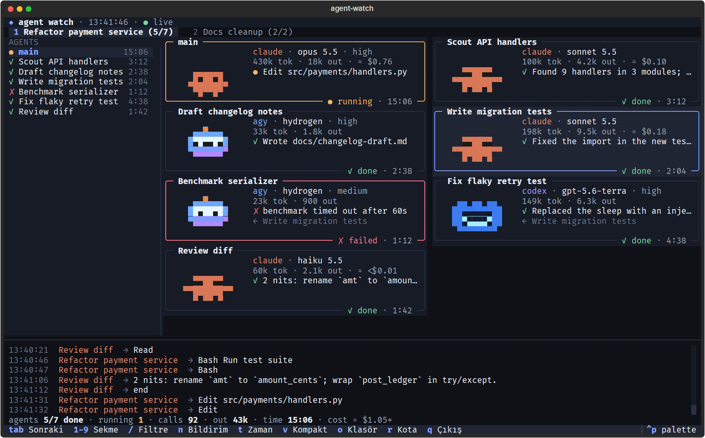
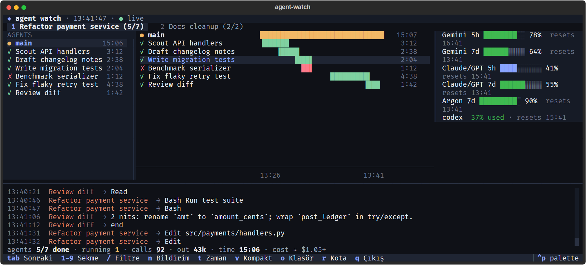
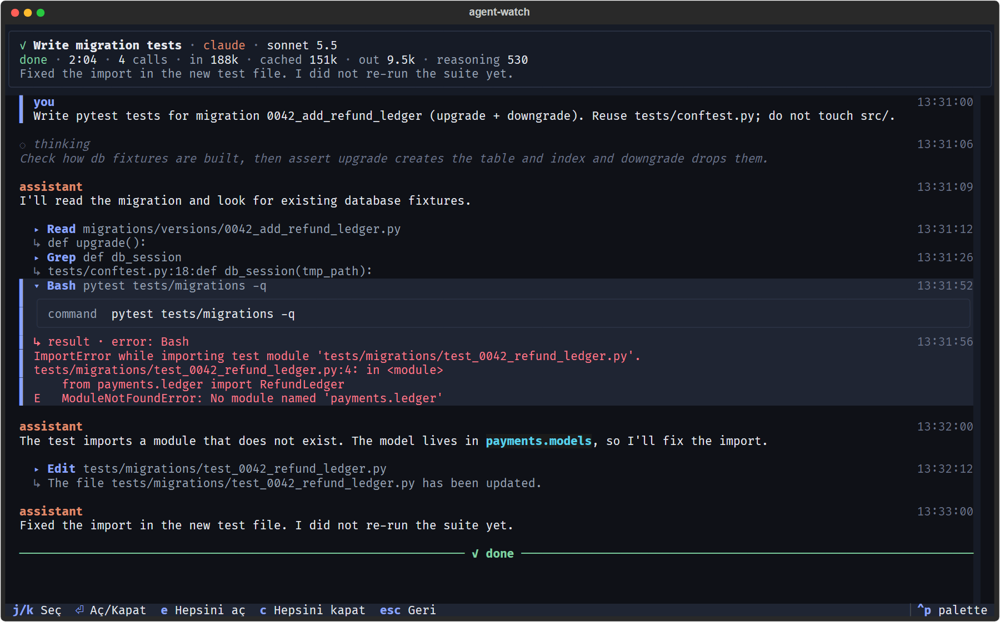
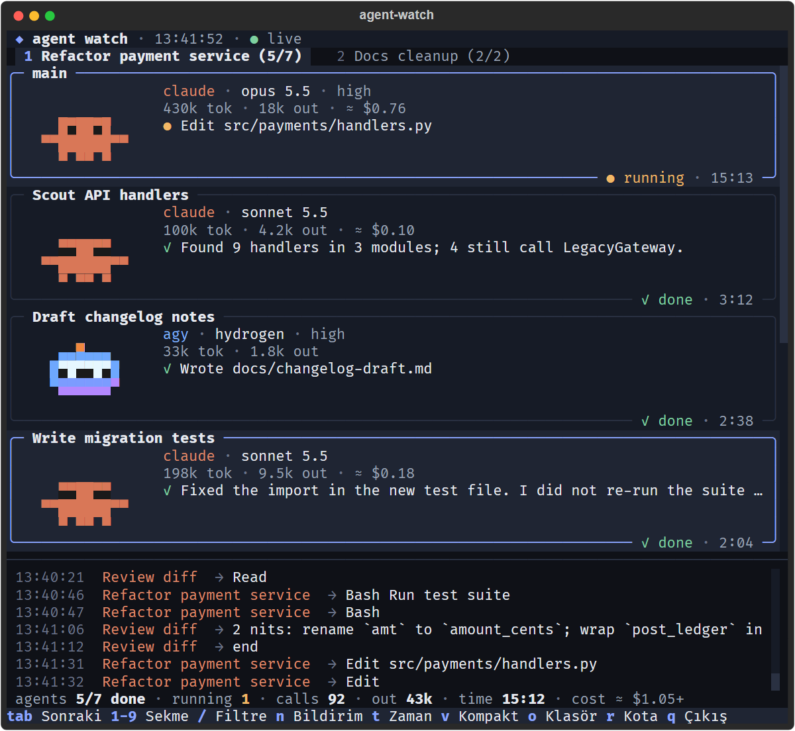

# agent-watch

A read-only Textual TUI that monitors your live Claude Code sessions in a separate terminal window — showing the Claude Code main agent, Claude subagents, Antigravity CLI (`agy`) runs, and Codex CLI (`codex`) runs side by side without narrowing your main Claude Code screen.

## Screenshots

All screenshots use invented demo data.



Timeline (`t`): one bar per agent across the session, with an optional quota panel on the right.



Conversation screen with one tool call expanded (here a failing `Bash` call).



Narrow layout (under 100 columns): the agent list and quota panel are hidden.



To regenerate them (needs Microsoft Edge for the SVG to PNG step):

```powershell
.venv\Scripts\python scripts/demo_screenshots.py
```

The script runs the real UI on a fake in-memory store; it never reads `~/.claude`, `~/.codex` or `~/.gemini`.

## Features

- **Separate window, live session tabs:** Tracks active Claude Code sessions automatically; finished agents remain visible on their session tab until the session closes (plus a 60s grace period).
- **One card per agent:** Displays source (`claude`, `agy`, `codex`) with an animated pixel mascot, model, effort level, elapsed time, cumulative tokens (`in + out` and `out`), status, and current step. Nested launches show `← <parent>`.
- **Read-only conversation view:** Open any card to inspect the chronological transcript (`▶ to agent`, `◀ agent`, thinking when logged, tool calls and truncated results, plus `in / cached / out / reasoning` token breakdown) with live tail-following while running.
- **Cost estimate:** Cards and the totals bar show an estimated cost (`≈ $0.18`) for Claude models only; `agy` and Codex agents are not priced, so a total with unpriced token usage is marked with a trailing `+`. It is a list-price estimate, not a bill.
- **Filter, notifications, timeline:** Filter agents with `/`, get a notification when an agent finishes or fails (`n` toggles), and switch the card grid to a per-session timeline with `t`.
- **Quota panel:** Shows `agy` usage buckets and Codex `rate_limits` when available.
- **Single-instance launcher:** Opening via `--new-window` reuses an existing window instead of spawning duplicates.

## Requirements

- Windows 11
- Python 3.13+

## Installation

```powershell
cd <repo>
python -m venv .venv
.venv\Scripts\pip install -e .
```

## Running

Run directly in the current terminal:

```powershell
.venv\Scripts\agent-watch
```

Or launch in a dedicated PowerShell window (prints `Agent Watch opened` or `Agent Watch already open`):

```powershell
.venv\Scripts\agent-watch --new-window
```

If `.venv\Scripts` is on your `PATH`, you can invoke `agent-watch` and `agent-watch --new-window` directly.

### Useful options

- `--new-window`: open in a separate PowerShell window if not already running.
- `--auto`: honor auto-open settings (`AGENT_WATCH_AUTO_OPEN=0` or `"auto_open": false` in `%LOCALAPPDATA%\agent-watch\config.json`) when paired with `--new-window`.
- `--no-quota`: disable `agy` quota polling.
- `--window-hours N`: lookback window in hours for `agy`/`codex` logs (default: `12`).
- `--claude-home`, `--agy-home`, `--codex-home`: override default `~/.claude`, `~/.gemini/antigravity-cli`, and `~/.codex` directories.

## Claude Code Integration

See [claude-mod/README.md](claude-mod/README.md) to configure automatic opening on Claude Code session start and register the `/agent-watch` slash command (with both `CLAUDE_CODE_PLUGIN_DIRS` mod setup and classic hook/command fallback instructions).

Set `AGENT_WATCH_AUTO_OPEN=0` to disable auto-open while keeping `/agent-watch`.

## Keybindings

### Dashboard

| Key / Input | Action |
|---|---|
| `Enter` / Click | Open the selected agent card (or sidebar item) in the conversation screen |
| `1`–`9` / Tab click | Switch to session tab 1–9 |
| `Tab` / `Shift+Tab` | Next / previous session tab |
| `/` | Filter agents (space-separated terms match title, source, status or model); `Enter` keeps the filter, `Esc` clears it |
| `n` | Toggle notifications when an agent finishes or fails (the header shows `notify off` when disabled) |
| `t` | Toggle the timeline view of the current tab (`Esc` also leaves it) |
| `v` | Toggle compact mode (hides sidebar and quota panel) |
| `o` | Open the agent's transcript folder (`agy` and Claude subagents) |
| `r` | Refresh `agy` quota |
| `q` | Quit |

### Conversation Screen

| Key / Input | Action |
|---|---|
| `j` / `k` (or `↓` / `↑`) | Select the next / previous tool call |
| `Enter` (or `Space`) | Expand or collapse the selected tool call (arguments and full result) |
| `e` | Expand all tool calls |
| `c` | Collapse all tool calls |
| `Esc` | Return to the dashboard |
| Scroll up / down | Pause or resume live tail-following |

## Read-Only Guarantee

`agent-watch` is strictly a passive observer:

- It never writes to or modifies `~/.claude`, `~/.codex`, or `~/.gemini`.
- It does not send messages, pick models/modes, or start/stop agents from the UI.
- Only launcher lock/config state is stored under `%LOCALAPPDATA%\agent-watch`.

## License

MIT — see [LICENSE](LICENSE).
